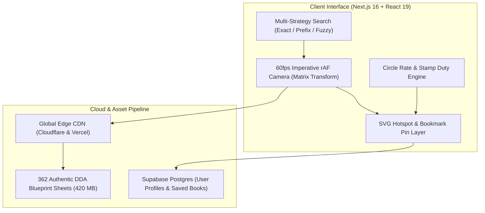

  
  <h1>PlotBook — Digitized DDA Layout Maps & Rohini Property Intelligence</h1>
  
<b>High-Fidelity Geospatial Blueprint Engine, 60fps Imperative Camera & Broker Due Diligence CRM</b>

  
<i>Transforming 362+ authentic Delhi Development Authority (DDA) layout plans across 36 sectors into an ultra-fast, interactive spatial platform.</i>

  

    
  

  

    
    
    
    
    
    
    
  

---

## 🌟 Executive Summary

**PlotBook** is an enterprise-grade geospatial mapping and land intelligence web platform engineered for real estate brokers, legal due diligence teams, and property buyers in Delhi, India.

Before PlotBook, verifying Delhi Development Authority (DDA) layout plans meant sifting through disjointed government portals, corrupted PDF files, and low-resolution physical blueprint prints. PlotBook organizes, indexes, and renders **362 high-resolution sector blueprints (~420 MB of authentic statutory maps) across Rohini Sectors 1–38** with zero degradation in pixel accuracy.

---

## 📸 Platform Overview

  
  
<i>Figure 1: High-resolution DDA layout blueprint viewer with interactive plot pins, search, and circle rate calculator.</i>

---

## ⚡ Core Capabilities

### 1. 🔍 "The Scan IS the Viewer" Architecture
- Streams untouched, full-resolution statutory DDA sheets directly to the browser.
- Zooming past 100% automatically switches to `image-rendering: pixelated`, exposing the raw print dots and authentic statutory stamps to legally verify plot boundaries.

### 2. ⚡ 60fps Imperative Camera Engine
- Single `requestAnimationFrame` camera loop calculating viewport matrices:
  - Wheel zoom-to-cursor
  - Multi-touch pinch-to-zoom on mobile
  - Kinetic drag-pan & double-click zoom
  - Animated `Fit View` and `1:1 Native Resolution` transitions
- **Zero React re-renders per frame:** All transformations write directly to hardware-accelerated CSS transforms.

### 3. 🎯 Multi-Strategy Spatial Search Index
- Custom weighted indexing engine resolving complex real estate syntax:
  - Priority: `Exact Phrase` > `Prefix Match` > `Sub-string Contains` > `Levenshtein Fuzzy`
  - Instantly parses natural broker queries: `29 b2`, `sector 9`, `GH-1`, `24 15a`, `pocket b-2`
  - Fly-to navigation with an animated 3-second amber pulse targeting the selected plot or pocket.

### 4. 💰 Delhi Circle Rate & Stamp Duty Calculator
- Computes statutory Delhi Government circle rates based on plot classification, sector categorization (Categories A through H), road width adjustments, and land-use factors.

### 5. 📍 Click-to-Pin & Interactive Hotspot Engine
- Interactive plot pin drops with persistent local and cloud storage.
- Custom SVG hotspot overlay layer highlighting individual plot numbers, orientations (park facing, corner plot), and dimensions.
- One-click export of branded, client-ready PDF plot reports and direct WhatsApp sharing.

---

## 🏗️ System Architecture

---

## 🛠️ Technical Specifications & Engineering Decisions

| Dimension | Engineering Decision | Rationale |
| :--- | :--- | :--- |
| **Framework** | **Next.js 16 (Turbopack)** | Instant route transitions and optimal server-rendered HTML for search crawlers and performance. |
| **Rendering** | **Imperative rAF Matrix Transform** | Avoided React state churn on mouse wheel/pinch events, achieving smooth 60fps even on low-end mobile devices. |
| **Search Engine** | **Client-Side Trie + Inverted Index** | Sub-15ms search latency across 36 sectors and hundreds of pockets with zero API network roundtrips. |
| **Vector Layers** | **SVG Hotspot Injection** | Allows programmatic hover, selection, and boundary tracing without modifying or re-sampling the raw underlying blueprint scan. |
| **Database** | **Supabase (PostgreSQL)** | Handles broker authentication, saved plot portfolios, and transactional client access logs. |

---

## 🔒 Source Code & Proprietary Rights

> [!IMPORTANT]  
> **Proprietary Commercial Platform**  
> PlotBook is a proprietary commercial SaaS platform.  
> The core production codebase, custom camera algorithms, search heuristics, and compiled vector datasets are private intellectual property.  
> 
> This public showcase repository demonstrates the system architecture, engineering decisions, and technical capabilities behind the platform.

---

## 👨‍💻 Engineering & Contact

**Aryan Bansal**  
*Full-Stack Engineer & Founder*  
- 🌐 **Live Platform:** [https://plotbook.webforge.me/](https://plotbook.webforge.me/)
- 💼 **Personal Portfolio:** [https://www.webforge.me](https://www.webforge.me)
- 🔗 **LinkedIn:** [linkedin.com/in/aryan-bansal-b29b69370](https://www.linkedin.com/in/aryan-bansal-b29b69370/)
- ✉️ **Contact:** `aryan24120@iiitd.ac.in` / `aryanbanc@gmail.com`

  © 2026 PlotBook • Powered by Webforge Network • All rights reserved.

