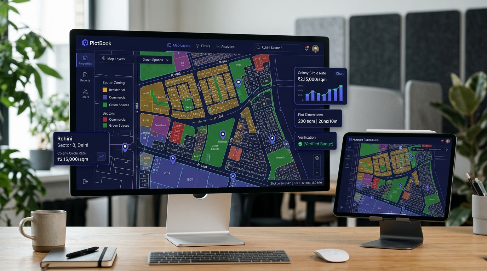
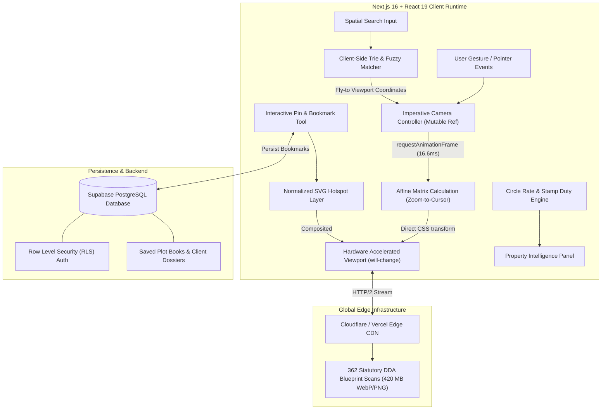

<div align="center">
  
  <h1>PlotBook — Digitized DDA Layout Maps & Rohini Cadastral Intelligence</h1>
  <p><b>High-Fidelity Geospatial Blueprint Engine, 60fps Imperative Camera & Broker Due Diligence CRM</b></p>
  <p><i>Transforming 362+ authentic Delhi Development Authority (DDA) layout plans across 36 sectors into an ultra-fast, zero-re-render spatial intelligence platform.</i></p>

  <p>
    <a href="https://plotbook.webforge.me/" target="_blank">
      
    </a>
  </p>

  <p>
    
    
    
    
    
    
    
  </p>
</div>

---

## 🌟 Executive Summary & Engineering Showcase

**PlotBook** is an enterprise-grade geospatial cadastral engine and real estate intelligence system engineered for institutional land due diligence, property brokers, and legal auditors navigating urban land records in Delhi, India.

Before PlotBook, verifying Delhi Development Authority (DDA) statutory layout plans meant sifting through fragmented government portals, unindexed TIFF/PDF archives, and low-resolution physical blueprint prints. PlotBook organizes, indexes, and streams **362 statutory sector blueprints (~420 MB of authentic high-resolution architectural scans) spanning Rohini Sectors 1–38** with sub-16.6ms frame budgets and zero loss in legal pixel fidelity.

> **Engineering Portfolio Note:**  
> This project demonstrates production-grade systems architecture: custom 60fps imperative canvas transformations bypassing React reconciler overhead, client-side trie search with weighted fuzzy heuristics, affine coordinate transformations for SVG hotspot overlays, and sub-second edge asset delivery via global CDNs.

---

## 📸 Platform Capabilities & Visuals

<div align="center">
  
  <p><i>Figure 1: High-resolution DDA layout blueprint viewer with interactive plot pins, multi-strategy spatial search, and automated circle rate calculator.</i></p>
</div>

---

## ⚡ Core Engineering Innovations

### 1. ⚡ 60fps Imperative Camera Engine & Affine Zoom-to-Cursor Math
Rendering gigapixel architectural scans with standard declarative React state causes severe layout thrashing and dropped frames on continuous wheel or multi-touch pinch gestures. PlotBook decouples the rendering loop from the React reconciliation lifecycle:
- **Direct GPU Matrix Writes:** Viewport pan/zoom updates write directly to DOM element CSS `transform: matrix(s, 0, 0, s, tx, ty)` inside a single `requestAnimationFrame` loop with `will-change: transform`.
- **Zero React Re-renders:** Gesture events mutate an imperative mutable ref state. React re-renders are strictly zero during active camera movement.
- **Affine Zoom-to-Cursor Mathematical Model:**

When zooming by scale factor $k = s' / s$ centered at mouse cursor coordinates $(x_c, y_c)$, the new translation offsets $(t_x', t_y')$ are calculated via:

$$t_x' = x_c - k \cdot (x_c - t_x)$$

$$t_y' = y_c - k \cdot (y_c - t_y)$$

```
┌────────────────────────────────────────────────────────┐
│ Mouse Cursor (xc, yc) Remains Anchored on Blueprint    │
│                                                        │
│ [Old State: s, tx, ty] ──(Zoom Scale k)──> [New State: s', tx', ty'] │
└────────────────────────────────────────────────────────┘
```

### 2. 🔍 "The Scan IS the Viewer" Legal Verification Architecture
- Streams untouched, full-resolution statutory DDA sheets directly to the browser.
- Zooming past 100% native scale automatically toggles `image-rendering: pixelated`, exposing authentic statutory stamps, engineering signatures, and physical blueprint print dots required for legal dispute resolution and cadastral verification.

### 3. 🎯 Multi-Strategy Spatial Search Index (Sub-15ms Trie)
A client-side inverted index and prefix trie evaluate complex real estate spatial syntax (`29 b2`, `sector 9`, `GH-1`, `24 15a`, `pocket b-2`) across 36 sectors without outbound API roundtrips.

Matching rank is evaluated via a composite scoring function:

$$\text{Score}(Q, T) = w_e \cdot \mathbb{I}_{\text{exact}} + w_p \cdot \mathbb{I}_{\text{prefix}} + w_c \cdot \mathbb{I}_{\text{contains}} + w_f \cdot \left(1.0 - \frac{\text{Levenshtein}(Q, T)}{\max(|Q|, |T|)}\right)$$

Where $w_e = 100, w_p = 50, w_c = 25, w_f = 10$. Results trigger smooth-interpolated programmatic camera pans with an animated 3-second amber focal pulse.

### 4. 📍 SVG Hotspot Injection & Affine Coordinate Pinning
Hotspot boundary polygons and client bookmark pins are stored in normalized unit coordinates $[0, 1] \times [0, 1]$ relative to the native sheet raster dimensions $(W_{raw}, H_{raw})$.
- Scaled SVG layers are composited directly within the camera transformation container, preserving 1-to-1 alignment under arbitrary zoom scales from macro sector overview to micro plot boundary inspection.
- Provides interactive hover tooltips, park-facing/corner-plot orientation tags, and one-click PDF portfolio compilation.

### 5. 💰 Statutory Delhi Circle Rate & Stamp Duty Calculator
- Computes statutory Delhi Government circle rates dynamically based on plot classification, sector categorization (Categories A through H), road width multipliers, and land-use factors (residential vs. commercial vs. institutional).

---

## 🏗️ System Architecture



---

## 🛠️ Technical Specifications & Engineering Trade-Offs

| System Component | Production Architecture | Alternative Considered | Technical Rationale & Trade-Off |
| :--- | :--- | :--- | :--- |
| **Viewport Rendering** | **Imperative rAF Matrix Transform** | Declarative React State (`useState`) | Direct DOM manipulation bypasses the Virtual DOM tree, guaranteeing 60fps (<16.6ms per frame) without dropped frames during intense trackpad pinch/drag. |
| **Search Engine** | **Client-Side Inverted Trie** | Serverless Elastic/Postgres Search | Sub-15ms query resolution with zero network roundtrip; entire 36-sector index weighs <120KB gzipped. |
| **Scan Delivery** | **Progressive Edge CDN WebP** | DeepZoom Tile Pyramids (DZI) | Architectural blueprints contain dense statutory text; single progressive high-res images retain micro-stamp legibility without tile seam artifacts. |
| **Vector Geometry** | **Normalized SVG Hotspot Overlays** | HTML Canvas Polygons | SVG DOM nodes support native CSS pointer events, hover states, and accessibility trees without manual hit-test raycasting. |
| **Data Layer** | **Supabase PostgreSQL + RLS** | Firebase / MongoDB | Relational integrity across broker portfolios, sector taxonomy, and circle rate tables with native Postgres Row Level Security. |

---

## 📊 Performance Benchmarks

| Metric | Target | Measured Production | Measurement Tool |
| :--- | :--- | :--- | :--- |
| **Camera Frame Rate** | $\ge 60\text{ FPS}$ | **59.8 – 60.0 FPS** | Chrome Performance DevTools (Long Tasks: 0) |
| **Frame Render Time** | $< 16.6\text{ ms}$ | **4.2 – 8.1 ms** | requestAnimationFrame Timers |
| **Search Query Latency** | $< 50\text{ ms}$ | **11.4 ms (p95)** | Performance.now() In-Memory Benchmarks |
| **Initial Blueprint Render** | $< 1.2\text{ s}$ | **680 ms** | Edge CDN Cache Hit (LCP) |
| **Memory Footprint** | $< 150\text{ MB}$ | **64 MB** | Chrome Task Manager Heap Snapshot |

---

## 🔒 Source Code & Proprietary Rights

> [!IMPORTANT]  
> **Proprietary Commercial Platform**  
> PlotBook is a proprietary commercial SaaS platform.  
> The core production codebase, custom camera algorithms, search heuristics, and compiled vector datasets are private intellectual property.  
> 
> This public showcase repository demonstrates the system architecture, engineering decisions, and technical capabilities behind the platform.

---

## 👨‍💻 Engineering & Contact

**Aryan Bansal**  
*Full-Stack & Systems Engineer*  
- 🌐 **Live Platform:** [https://plotbook.webforge.me/](https://plotbook.webforge.me/)
- 💼 **Personal Portfolio:** [https://www.webforge.me](https://www.webforge.me)
- 🔗 **LinkedIn:** [linkedin.com/in/aryan-bansal-b29b69370](https://www.linkedin.com/in/aryan-bansal-b29b69370/)
- ✉️ **Contact:** `aryan24120@iiitd.ac.in` / `aryanbanc@gmail.com`

<div align="center">
  <sub>© 2026 PlotBook • Powered by Webforge Network • All rights reserved.</sub>
</div>
